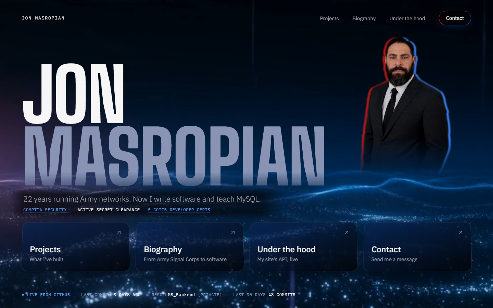

# jonmasropian.com

Personal portfolio of **Jon Masropian**: retired U.S. Army veteran (22 years, Signal Corps) and Software Developer Apprentice at ERA Solutions.

**Live:** [www.jonmasropian.com](https://www.jonmasropian.com)



## What's on it

| Page | What it does |
|---|---|
| `/` | Name, portrait, tagline, credentials line, four doors, live GitHub status, record and stack |
| `/projects` | Three projects with live links and code |
| `/biography` | Career route (Army to apprenticeship) and seven certifications (CompTIA Security+, five CoITB, Era Academy) with verification links |
| `/contact` | Contact form that emails me through Resend |
| `/under-the-hood` | Documentation for the site's own API, with "Try it" buttons that make real requests |

## Stack

- **Next.js 16** (App Router), **React 19**, **TypeScript**
- **Tailwind CSS v4** with design tokens in `src/styles/tailwind.css`
- **Resend** for contact email, **GitHub REST API** for the activity strip
- Deployed on **Vercel**

## API routes

- `GET /api/github`: recent commit activity, cached for 10 minutes so visitors never hit GitHub's rate limit.
- `POST /api/contact`: server-side validation, a honeypot field for bots, and a limit of 3 messages per 10 minutes per visitor.

Both are documented live at [/under-the-hood](https://www.jonmasropian.com/under-the-hood).

## Run it locally

```bash
npm install
npm run build && npm start   # http://localhost:3000
```

Optional environment variables in `.env.local`:

| Variable | Used for |
|---|---|
| `GITHUB_TOKEN` | Read-only token so the home strip can show a private repo's commit activity (falls back to public events without it) |
| `RESEND_API_KEY` | Sending contact-form email (the form shows a "email me directly" message without it) |

## Tests

```bash
node --test src/lib/*.test.ts
```

Covers the GitHub activity summaries, and contact-form validation and rate limiting.

## Accessibility

Keyboard focus rings throughout, reduced-motion support (the background video pauses and animations show their final state), a "Pause background" control, labelled form fields with announced errors, and screen-reader text on every new-tab link.

## Design

The design system (colors, type, components, motion) is documented in [DESIGN.md](DESIGN.md).
